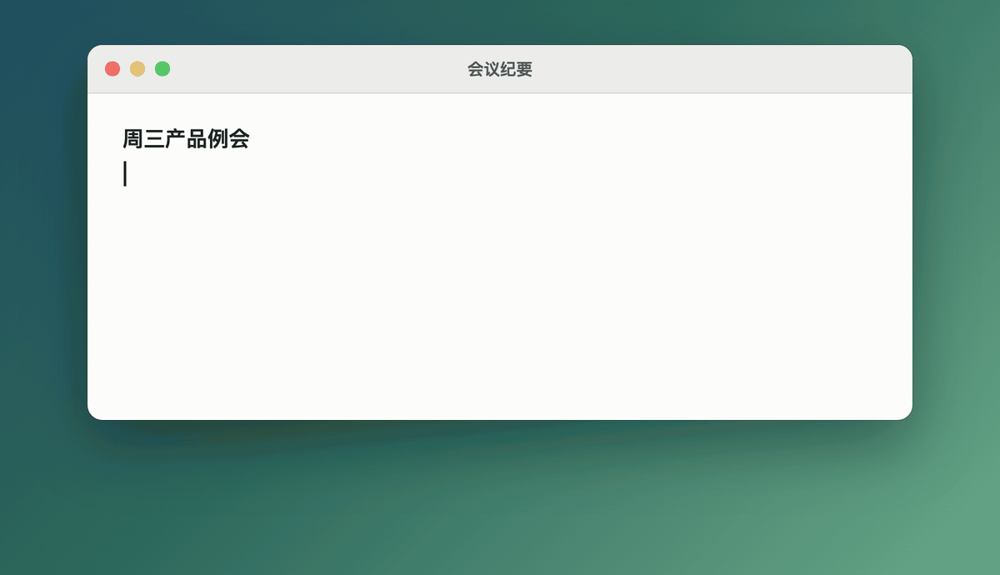

# ChillTalk

  

**简体中文** | [English](README.en.md)

macOS 菜单栏语音输入。轻按快捷键开始说话，再按一次结束，润色后的文字直接出现在光标处。

主打**专业名词识别**：个人词库、纠正学习、按发音纠错、行业词库。

## 为什么做这个

Typeless 挺好用，就是要按月订阅，而且功能多到我用不完。我只想张嘴说话、字出现在光标处，就这么简单。

ChillTalk 就只干这件事：直接调通义千问的 API（也支持 AssemblyAI、Deepgram、Soniox、OpenAI、OpenRouter，随你挑），用多少付多少。用千问的话，每天说半小时也就 ¥10 一个月，新用户的免费额度还能先白嫖好几个月。

## 功能

- 全局快捷键（默认右 ⌥），Esc 取消；可选「实时」（边说边出字）或「说完再识别」（更便宜、通常更准）
- 6 家识别服务可选：千问 / 阿里云百炼、AssemblyAI、Deepgram、Soniox、OpenAI、OpenRouter；千问可按识别方式选择模型
- 大模型润色：去口头禅、补标点、处理口误，不改原意
- 词库：热词、重点词、背景说明、错误写法自动替换、同音字纠正、行业词库
- 纠正上一句：按另一个快捷键，说「把张三改成章山」或者重说一遍，刚输入的文字直接被替换；听错的词会记进词库
- 在历史里纠正说错的词，一键记成规则
- 录音提示框可以拖动，每块屏幕记住各自的位置
- 6 种口述语言、5 种界面语言
- 历史与用量统计、iCloud 同步、可选语音增强（回声消除 + 降噪）

## 安装

从 [Releases](https://github.com/rampagege/ChillTalk/releases) 下载最新的 `.dmg`，打开后把 ChillTalk 拖到旁边的「应用程序」文件夹。需要 macOS 14+。

本版本未经苹果公证，首次打开会提示无法验证开发者：到 系统设置 → 隐私与安全性 点「仍要打开」。

## 使用

1. 授予**麦克风**和**辅助功能**权限
2. 菜单栏图标 → 设置… → 语音识别：选服务商、填 API 密钥、点「测试连接」
3. 在任意输入框轻按右 ⌥ 说话，再按一次结束

推荐识别和润色都用[千问 AI 平台](https://www.qianwenai.com/)（即阿里云百炼，按量付费）申请的密钥，一个密钥搞定。

| 识别服务 | 价格（约） | 新用户免费额度 | 备注 |
|---|---|---|---|
| 千问 / 阿里云百炼 | 实时 ¥0.5/小时 说完再识别 ¥0.1/小时 | 开通后 90 天内，**每个模型单独送**：按秒计费的模型 10 小时，3.1 系列 100 万 Token（约 12 小时） | 推荐，中文效果好，同一密钥可用于润色 |
| AssemblyAI | 实时 $0.45/小时 说完再识别 $0.21/小时 | $50，不过期，无需绑卡 | 服务在美国 |
| Deepgram | $0.46/小时 | $200，不过期，无需绑卡 | 仅实时；中文按普通话识别 |
| Soniox | $0.12/小时 | 无（2025 年 10 月起取消） | 仅实时；中英混说好 |
| OpenAI / OpenRouter | 约 $0.36/小时 | 无 | 仅说完再识别；中文较弱 |

价格和赠送额度以各家官网为准（2026 年 10 月整理）。剩余额度需到各家控制台查看。

## 隐私

录音只发给你选择的识别服务商，ChillTalk 不保存音频。开启润色时，识别出的文字会发给你选择的润色服务商。API 密钥存在 macOS 钥匙串，不会同步或上传。历史和词库保存在本机，开启 iCloud 同步后另存一份到你的 iCloud 云盘。

## 许可证

MIT
